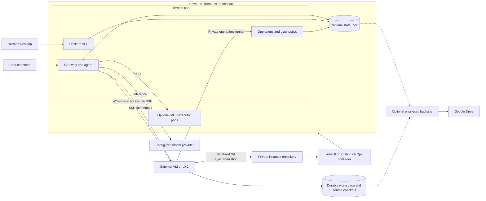
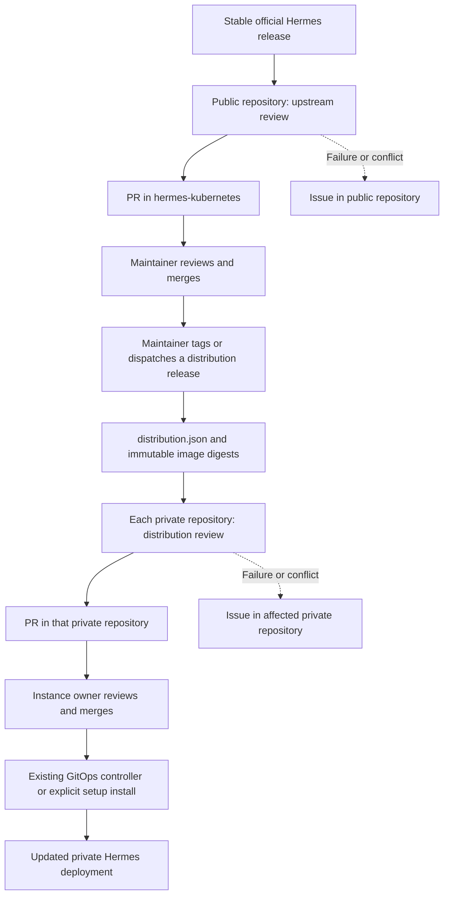

# Hermes Kubernetes

Run [Hermes Agent](https://github.com/NousResearch/hermes-agent) in Kubernetes,
with an external SSH terminal and isolated MCP executors. Keep native Desktop/API
management of plugins, connectors, skills and profiles, while preserving code
inspection, debugging and reproducible updates.

This repository contains the shared distribution. Each installation has an
**independent private repository**, its own state volumes, credentials and
backups. You do not need a private GitHub fork of this public repository.

## Architecture

The system separates the running assistant, its terminal and the source used to
build it. Kubernetes owns the assistant's durable runtime state; the terminal
provides a workspace where the assistant can run commands and inspect its code.
An independent private repository owns each installation's desired state.



| Component | Responsibility | Persistence |
|---|---|---|
| Hermes pod | Native gateway and agent, Desktop API, private operations and terminal diagnostics; containers share one state volume | Runtime PVC: conversations, SQLite, profiles, skills, plugin state and configuration |
| External terminal | Shell commands, project work, source inspection and debugging | Durable workspace outside the disposable OS disk when using managed provisioning |
| Optional MCP executors | Separate API, browser and workspace execution roles, with explicit routing and scoped access | Separate executor data volumes; workspace access is explicitly configured |
| Model provider | Inference through a configured API, including an existing CLIProxyAPI | Managed independently; the installer does not deploy the provider |
| Private instance repository | Release lock, deployment overlay, sanitized customizations and installation settings | Git history; secrets and runtime databases are excluded |
| Public distribution | Shared integration code, focused upstream patches, dependency locks, container builds and releases | Public Git history and published images |

The core image uses AlmaLinux 10's explicit **x86-64-v2** image. General/browser
MCP executors use Alpine; Codegraph uses a separate glibc image. The terminal can
be a VM or LXC; Ubuntu is an option, not a requirement. The terminal's OS is
replaceable when its durable workspace is stored independently.

The base installation creates one Hermes Deployment with gateway, dashboard,
operations and diagnostics containers. MCP executors are optional extensions,
not extra copies of Hermes. A connector uses its configured executor role;
arbitrary new MCP packages require an explicit choice of permissions and executor.
See the [executor setup](deploy/kubernetes/executors/README.md).

### Interface, self-management and state

Plugins, connectors, skills and profiles remain manageable through native Hermes
Desktop/API. Runtime changes persist on the PVC. The workspace controller
projects supported customizations into private Git without copying credentials,
databases or dependency caches. Every runtime profile has an independent `.env`.

The terminal has an inspectable upstream checkout rebuilt from the pinned
revision and patches. It reaches the running assistant's self-management
operations through a private SSH tunnel; it does not need cluster administrator
credentials. Common code changes belong in this public distribution, while
personal skills and configuration belong in the private instance.

SQLite databases, WAL/SHM files, conversations and OAuth tokens stay in durable
storage and encrypted backups. Git stores reproducible source, locks and
sanitized desired state. Replacing a pod or terminal OS is safe only when its
durable storage and recovery credentials are preserved.

### Network boundaries

The namespace base restricts traffic to namespace-local peers and cluster DNS.
Installation settings add explicit SSH, model-provider and API egress rules.
This requires a CNI that enforces NetworkPolicy. Public HTTP/HTTPS egress is an
explicit option; private infrastructure still needs an allowlist.

The installer can use an existing cluster Tailscale route. It does not require
a dedicated Tailscale pod or create a tailnet. The Desktop API is a ClusterIP
Service by default; local access uses an authenticated port-forward.

## Start an installation

### Prerequisites

- Kubernetes access with kubectl, an enforcing NetworkPolicy CNI and a suitable
  StorageClass.
- Python 3.12+, Git and OpenSSH on the operator machine; GitHub CLI for the
  repository-creation command below.
- A reachable model API and either an existing SSH terminal with Python 3.12+
  and Git, or Proxmox provisioning credentials.
- For managed VM/LXC provisioning: OpenTofu, Ansible, a static guest address and
  an existing dedicated CephFS workspace/client. A VM also needs an Ubuntu
  cloud-init template. These storage and infrastructure prerequisites are not
  created by the installer.

### Configure and install

Clone the shared distribution and generate an independent installation from a
published stable release:

```sh
git clone https://github.com/jerbao/hermes-kubernetes.git
cd hermes-kubernetes
python3 -m hermes_kubernetes.instances.generator --directory ../my-hermes --release v0.2.0
cd ../my-hermes
python3 hermes.py setup init
```

Edit the generated, ignored `.env`; [.env.example](.env.example) documents the
settings. You do not need to edit shared Python code or deployment templates.

| Settings | What to configure |
|---|---|
| Assistant and cluster | `ASSISTANT_NAME`, `KUBERNETES_NAMESPACE`, optional context/timezone and PVC size/class |
| Inference | `MODEL`, `MODEL_BASE_URL`, `MODEL_API_KEY` and provider network permissions |
| Terminal | `TERMINAL_KIND=existing`, `vm` or `lxc`; SSH address, workspace and private credential file paths |
| Private Git synchronization | `INSTANCE_REPOSITORY` and an instance-scoped deploy key with pinned GitHub host keys |
| Optional provisioning | Proxmox connection, guest resources and dedicated CephFS credentials |
| Optional backups | Own Google Desktop OAuth client, encrypted rclone configuration and backup policy |

The installer `.env` belongs to the operator's private checkout. It is separate
from native Hermes profile `.env` files and is not transferred to the agent.
Use `RUNTIME_ENV_FILE` for default-profile channel credentials, or configure
channels through Desktop. Pin SSH host keys using an already trusted connection.

Review the plan, commit the generated non-secret desired state and create your
private GitHub repository before installation:

```sh
python3 hermes.py setup plan
python3 hermes.py setup configure
gh repo create my-hermes --private --source . --remote origin --push
# Match origin to the SSH URL configured in INSTANCE_REPOSITORY, if using Git sync.
git remote set-url origin git@github.com:YOUR_OWNER/my-hermes.git
python3 hermes.py setup install
python3 hermes.py setup connect
```

Open `http://127.0.0.1:9119`, or enter it in Hermes Desktop while `connect` is
running. The API token is in `.local/credentials/dashboard-token` unless you set
`DASHBOARD_TOKEN` yourself.

`plan` validates settings without contacting infrastructure unless `--infra` is
selected. `configure` generates and commits sanitized manifests. `install`
optionally provisions the terminal, prepares its workspace, streams Secrets to
Kubernetes and deploys the pinned images. It refuses destructive guest plans.
The generator refuses an existing destination directory.

The first deployment uses kubectl. For continuous GitOps reconciliation, point
your existing ArgoCD Application at the private instance overlay; the installer
does not create an ArgoCD installation or its repository credentials. Without a
controller, apply reviewed changes explicitly with `setup install`.

See the [complete configuration guide](docs/installation/environment.md) for
existing terminals, managed VM/LXC provisioning, network permissions, profile
credentials and Google Drive authentication. Backups and MCP executor deployment
are optional; the base does not install unrelated browser or desktop services.

## Updates

There are **two separate update reviews**, each opening a PR in the repository
that owns the change:



| Workflow | Where it runs | Trigger | Result |
|---|---|---|---|
| [Review official Hermes release](.github/workflows/upstream-release.yml) | Public distribution | Daily at 10:23 UTC, or manual dispatch | Reviews stable official Hermes releases, applies patches, runs candidate checks and opens a public PR when the pin changes |
| [Publish distribution release](.github/workflows/release.yml) | Public distribution | `v*` tag push, or manual dispatch | Tests/builds Hermes and both MCP images, then publishes a stable release manifest |
| [Review shared Hermes updates](examples/instance/.github/workflows/update.yml) | Each generated private instance | Daily at 11:43 UTC, or manual dispatch | Checks stable `hermes-kubernetes` releases, reconciles private skills and opens a PR in that instance |

These schedules are GitHub Actions cron triggers, with execution time subject
to GitHub scheduling. The private workflow is a scaffold here: it only becomes
active in an instance repository after generation and push. Existing private
repositories need to adopt this instance layout; publishing the public project
does not rewrite or replace their older workflows.

Public CI checks pushes and PRs; it does **not** publish a stable distribution on
every commit. A release's `distribution.json` binds its source commit and all
three image digests. Private instances consume that release rather than merging
the public source tree or rebuilding the common images individually.

Neither review automatically merges its PR. The public workflow has no private
repository or deployment credentials. Each private workflow uses its own
`GITHUB_TOKEN`; it needs no shared token with access to everybody's repositories.

Skills use three-way reconciliation, preserving compatible personal edits.
Conflicts stop the candidate before a PR is opened or any active skill is
overwritten. Failed reviews/publications create or update an issue in the
affected repository, with a workflow link and maintainer mentions. Recovery
closes the incident. GitHub email/push delivery follows your notification
settings.

In each repository, enable Issues and allow Actions to create pull requests.
Optionally set `UPSTREAM_ALERT_USERS` to comma-separated GitHub usernames;
otherwise the owner is mentioned. Run the review workflow manually once to
confirm its permissions and configure your GitHub notification subscriptions.
An organization should set actual maintainer usernames instead of relying on
its organization name.

See [update and conflict handling](docs/development/updates.md) and
[private repository setup](docs/installation/private-instances.md).

## Development

```sh
python3 -m pip install -r requirements-dev.txt
make checkout
make validate test
make test-hermes
make build IMAGE=hermes-kubernetes:local
```

`hermes-agent/` is an ignored checkout rebuilt from `upstream.lock.json` and
`patches/`. Dependencies, SQLite databases, conversations, OAuth files and caches
are not committed. [Directory guide](docs/structure.md).

## Further reading

- [Installation and environment settings](docs/installation/environment.md)
- [Private instances, credentials and update permissions](docs/installation/private-instances.md)
- [Release publication and skill conflict handling](docs/development/updates.md)
- [Optional MCP executor deployment](deploy/kubernetes/executors/README.md)
- [Repository directories and versioned files](docs/structure.md)

Upstream licenses and attribution: [LICENSE](LICENSE), [NOTICE](NOTICE).

Subscription limits for custom CLIProxy-backed providers are available through the
optional [read-only quota adapter](docs/proxy-quotas.md).
