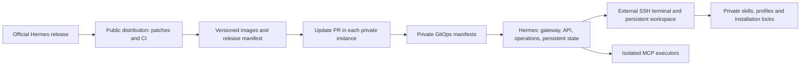

# Hermes Kubernetes

Run [Hermes Agent](https://github.com/NousResearch/hermes-agent) in Kubernetes,
with an external SSH terminal and isolated MCP executors. Keep native Desktop/API
management of plugins, connectors, skills and profiles, while preserving code
inspection, debugging and reproducible updates.

This repository contains the shared distribution. Each installation has an
**independent private repository**, its own state volumes, credentials and
backups. You do not need a private GitHub fork of this public repository.

## Architecture



The core image uses AlmaLinux 10's explicit **x86-64-v2** image. General/browser
MCP executors use Alpine; Codegraph uses a separate glibc image. The terminal can
be a VM or LXC; Ubuntu is an option, not a requirement. The terminal's OS is
replaceable when its durable workspace is stored independently.

## Start an installation

Use a published stable distribution release, then create a private repository:

```sh
python3 scripts/create_instance.py --directory ../my-hermes --release v0.1.0
cd ../my-hermes
# Review instance.json and your private Kubernetes overlay.
gh repo create my-hermes --private --source . --push
```

See [installation](docs/instalacao.md) for credentials, networking and activation.
The generator refuses to overwrite existing files. It creates a version lock,
bootstrap CLI and update workflow; it does not put personal state in this repo.
Your private GitOps repository controls deployment, including image promotion.

## Updates

Change common code here once. CI tests it and publishes digest-addressed images.
A stable release contains `distribution.json`, binding the source commit and
all three image digests. Private repositories check daily and propose a PR;
merging is the owner's decision. A failed update creates a GitHub issue.

Skills use three-way reconciliation, preserving compatible personal edits.
Conflicts stop the candidate before any active skill is overwritten. Publishing
an image never grants the public workflow access to a private deployment.
See [updates](docs/atualizacoes.md) and [private instances](docs/instancias.md).

## Development

```sh
python3 -m pip install -r requirements-dev.txt
make checkout
make validate test
make test-hermes
make build IMAGE=hermes-kubernetes:local
```

`hermes-agent/` is an ignored checkout rebuilt from `upstream.lock.json` and
`patches/`. Dependencies, SQLite databases, conversations, OAuth files and caches
are not committed. [Directory guide](docs/estrutura.md).

Upstream licenses and attribution: [LICENSE](LICENSE), [NOTICE](NOTICE).
